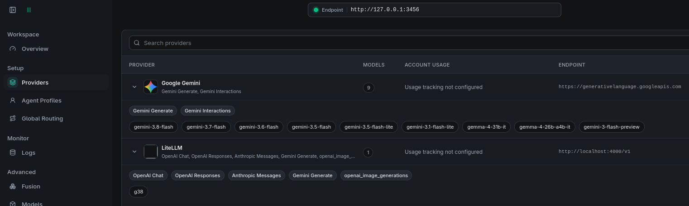
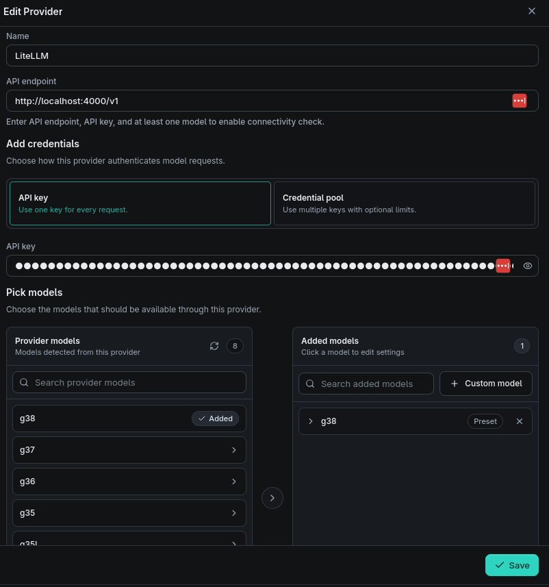
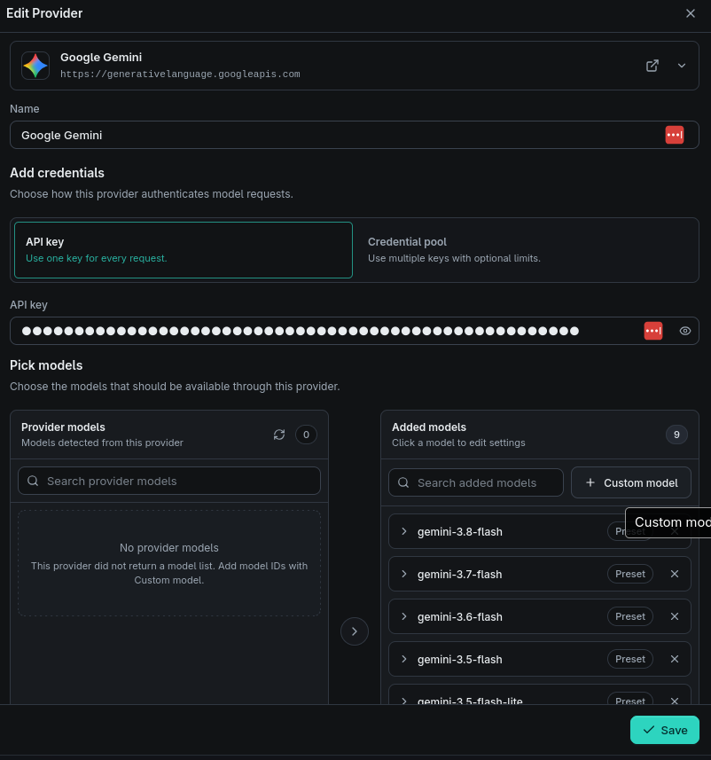
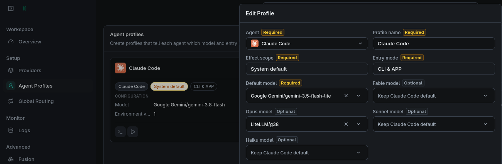
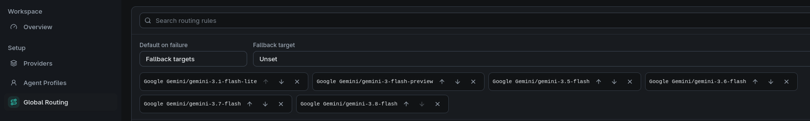
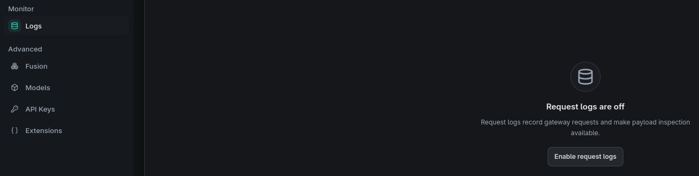
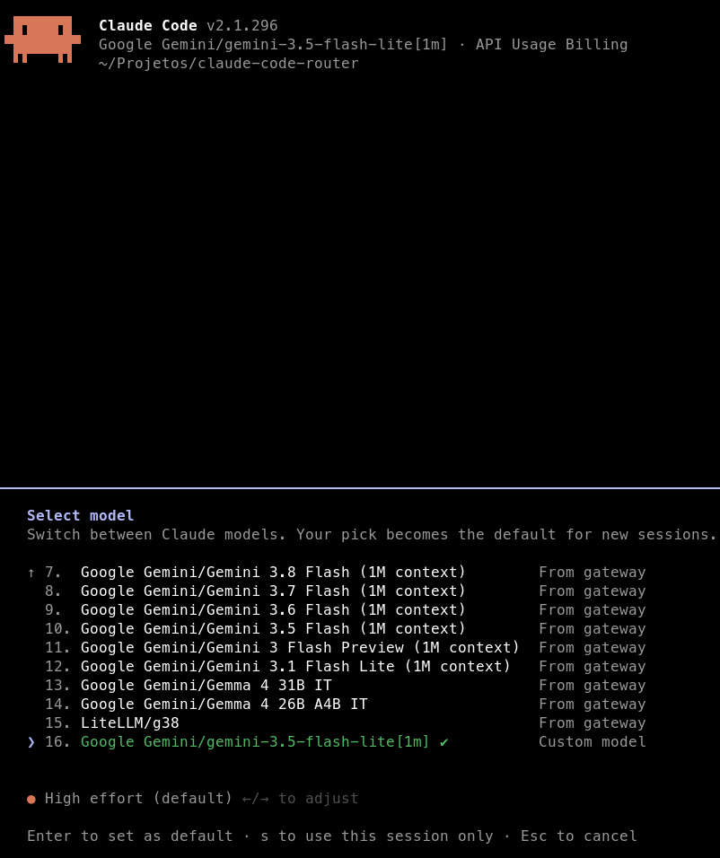

# Claude Code Router (CCR) + LiteLLM with Gemini

This setup sends Claude Code requests through CCR straight to the Gemini API. Thinking requests (Opus model) go through LiteLLM instead. When a model fails, CCR or LiteLLM falls back to the next one in the chain. CCR is patched so it waits **1 s** after both HTTP errors (429/5xx) and network errors.

```
Claude Code → CCR ─┬─ Default → Gemini API (gemini-3.5-flash-lite)
                   └─ Opus    → LiteLLM (:4000) → Gemini API (fallback chain)
```

## 1. Prerequisites

```bash
# Node 24 via nvm
curl -o- https://raw.githubusercontent.com/nvm-sh/nvm/master/install.sh | bash
source ~/.bashrc
nvm install 24

# Python + pipx + jq (Debian/Ubuntu)
sudo apt install -y pipx jq && pipx ensurepath
```

## 1.1 Get API keys

### Google AI Studio (Gemini)

1. Go to <https://aistudio.google.com> and sign in with your Google account.
2. Open **Get API key** (<https://aistudio.google.com/apikey>), then click **Create API key**.
3. Choose **Create API key in new project**, or pick an existing Google Cloud project. Each project has its own quota.
4. Copy the key and save it as `GEMINI_API_KEY` in `~/.config/litellm/env`.
5. Check your limits per model (RPM, TPM and RPD) at <https://aistudio.google.com/rate-limit>. Use the project selector at the top of that page.
6. Optional: to raise the free-tier limits, click **Set up billing** on the API key page. This moves the project to **Tier 1**, which is paid.

> The quota belongs to the **project**, not the key. Creating more keys in the same project doesn't give you more requests.

### OpenRouter

1. Go to <https://openrouter.ai> and sign in.
2. Open **Settings → Keys** (<https://openrouter.ai/settings/keys>), then click **Create Key**.
3. Give it a name and, optionally, a **credit limit**. Copy the key, which starts with `sk-or-v1-`.
4. Save it as `OPENROUTER_API_KEY` in `~/.config/litellm/env`.
5. Check your usage and limits at <https://openrouter.ai/activity>.

> `:free` models have rate limits: about 20 RPM, and **50 requests per day**, or **1,000 per day** once you've bought at least 10 credits.

## 2. Install

```bash
pipx install 'litellm[proxy]'                    # -> ~/.local/bin/litellm
npm i -g @musistudio/claude-code-router
```

## 3. Configure LiteLLM

### `~/.config/litellm/env` (chmod 600)

```bash
mkdir -p ~/.config/litellm
cat > ~/.config/litellm/env <<'EOF'
GEMINI_API_KEY=<YOUR_GEMINI_KEY>
OPENROUTER_API_KEY=sk-or-v1-<YOUR_OPENROUTER_KEY>
LITELLM_MASTER_KEY=sk-<GENERATE_WITH_openssl_rand_-hex_32>
EOF
chmod 600 ~/.config/litellm/env
```

> See `env.example` in this repo for the format. It contains placeholder values only.

### `~/.config/litellm/litellm.yaml`

```yaml
general_settings:
  master_key: os.environ/LITELLM_MASTER_KEY

model_list:
  - model_name: g38
    litellm_params: { model: gemini/gemini-3.8-flash, api_key: os.environ/GEMINI_API_KEY }
  - model_name: g37
    litellm_params: { model: gemini/gemini-3.7-flash, api_key: os.environ/GEMINI_API_KEY }
  - model_name: g36
    litellm_params: { model: gemini/gemini-3.6-flash, api_key: os.environ/GEMINI_API_KEY }
  - model_name: g35
    litellm_params: { model: gemini/gemini-3.5-flash, api_key: os.environ/GEMINI_API_KEY }
  - model_name: g3fp
    litellm_params: { model: gemini/gemini-3-flash-preview, api_key: os.environ/GEMINI_API_KEY }
  - model_name: g35l
    litellm_params: { model: gemini/gemini-3.5-flash-lite, api_key: os.environ/GEMINI_API_KEY }
  - model_name: g31l
    litellm_params: { model: gemini/gemini-3.1-flash-lite, api_key: os.environ/GEMINI_API_KEY }
  - model_name: g431
    litellm_params: { model: gemini/gemma-4-31b-it, api_key: os.environ/GEMINI_API_KEY }
  - model_name: g426
    litellm_params: { model: gemini/gemma-4-26b-a4b-it, api_key: os.environ/GEMINI_API_KEY }

router_settings:
  fallbacks:
    - g38: [g37, g36, g35, g3fp, g35l, g31l, g431, g426]
  num_retries: 0
```

> `master_key` is read from the env file, so the key never appears in the YAML.

## 4. systemd user services

### `~/.config/systemd/user/litellm.service`

```ini
[Unit]
Description=LiteLLM Proxy
After=network-online.target
Wants=network-online.target

[Service]
EnvironmentFile=%h/.config/litellm/env
ExecStart=%h/.local/bin/litellm --config %h/.config/litellm/litellm.yaml --port 4000
Restart=on-failure
RestartSec=5

[Install]
WantedBy=default.target
```

### `~/.config/systemd/user/ccr.service`

```ini
[Unit]
Description=Claude Code Router
After=network.target litellm.service
Wants=litellm.service

[Service]
Type=forking
Environment=PATH=%h/.nvm/versions/node/v24.21.0/bin:%h/.local/bin:/usr/local/bin:/usr/bin:/bin
ExecStart=%h/.nvm/versions/node/v24.21.0/bin/ccr start
ExecStop=%h/.nvm/versions/node/v24.21.0/bin/ccr stop
Restart=on-failure
RestartSec=5
TimeoutStartSec=30

[Install]
WantedBy=default.target
```

> Change `v24.21.0` to match your Node version (`node -v`).

### Enable the services

```bash
systemctl --user daemon-reload
systemctl --user enable --now litellm ccr
loginctl enable-linger "$USER"   # keeps the services running after logout
```

## 5. Configure CCR (web UI)

CCR now keeps its configuration in a **SQLite database** instead of `~/.claude-code-router/config.json`, so you set it up in the web UI. Editing the old JSON file does nothing.

### 5.1 Open the UI

Start CCR (section 4), then open the URL with the token from the log:

```bash
journalctl --user -u ccr -n 50 --no-pager | grep -o "http://127.0.0.1:[0-9]*/?ccr_web_token=[^ ]*" | tail -1
```

### 5.2 Add the providers

1. Go to **Providers → Google Gemini**. Enter your Gemini API key and add these model IDs with **Custom model**: `gemini-3.8-flash`, `gemini-3.7-flash`, `gemini-3.6-flash`, `gemini-3.5-flash`, `gemini-3-flash-preview`, `gemini-3.5-flash-lite`, `gemini-3.1-flash-lite`, `gemma-4-31b-it` and `gemma-4-26b-a4b-it`.
2. Go to **Providers → LiteLLM**. Set the endpoint to `http://localhost:4000/v1`, use `LITELLM_MASTER_KEY` as the API key, and add the model `g38`.







### 5.3 Create the agent profile

1. Go to **Agent Profiles** and click **New profile** (or edit the existing one).
2. Fill in the fields:

| Field | Value |
|---|---|
| Agent | `Claude Code` |
| Profile name | `Claude Code` |
| Effect scope | `System default` |
| Entry mode | `CLI & APP` |
| Default model | `Google Gemini/gemini-3.5-flash-lite` |
| Opus model | `LiteLLM/g38` |
| Sonnet / Haiku / Fable model | Optional. Leave as *Keep Claude Code default*, or set each one to a LiteLLM model |

3. Save. The card should show the profile with **System default** and **CLI & APP**.

> `gemini-3.5-flash-lite` is the default because it allows 500 requests per day. Thinking requests (Opus model) go through LiteLLM's fallback chain. Requests to a direct Gemini model skip LiteLLM.

> Use `/model opus` to switch to Opus, or `/model opusplan` to use Opus only in plan mode and the default model for everything else.



### 5.4 Set the routing

1. Go to **Global Routing** and set **Default** to `Google Gemini/gemini-3.5-flash-lite`.
2. Set **Default on failure** to *Fallback targets* and put the Gemini models in order. CCR uses these as a backup if **Default** itself goes down.
3. Save. The changes are written to SQLite right away.



### 5.5 Enable request logs

1. Go to **Monitor → Logs** and click **Enable request logs**.
2. Send a prompt from Claude Code, then refresh the page. Each request shows the agent profile, the model it was routed to, the status, and whether the fallback targets were used.
3. Default requests should go to **Google Gemini/gemini-3.5-flash-lite**, and Opus requests to **LiteLLM/g38**.

> Request logs keep full payloads (prompts, code, responses) in CCR's SQLite database. Turn them off when you finish debugging if you work with sensitive code.



### 5.6 Alias to open the UI

Add this to `~/.bashrc`:

```bash
# Claude Code Routing UI
alias ccr-ui='xdg-open "$(journalctl --user -u ccr -n 50 --no-pager | grep -o "http://127.0.0.1:[0-9]*/?ccr_web_token=[^ ]*" | tail -1)"'
```

## 6. Patch: 1 s retry wait in CCR (HTTP and network errors)

The minified function names (`aue`, `cue`, `Jet`, `bA`, `zet`, `due`) belong to the **current version** of CCR. Updating CCR undoes the patch, and the names may change.

```bash
cd "$(npm root -g)/@musistudio/claude-code-router/dist/main"
[ -f cli.js.orig ] || cp cli.js cli.js.orig     # backup only once

perl -pi -e 's/function aue\(e,t\)\{let r=Jet\(e\.get\("retry-after"\)\);return r!==void 0&&r>0\?bA\(r,1,zet\):due\(t\)\}/function aue(e,t){return 1e3}/; s/function cue\(e\)\{return due\(e\)\}/function cue(e){return 1e3}/' cli.js

grep -o -E 'function (aue|cue)\([^)]*\)\{return [^}]*\}' cli.js
```

Expected output:

```
function aue(e,t){return 1e3}
function cue(e){return 1e3}
```

| Function | Used for | Value |
|---|---|---|
| `aue` | HTTP errors (429/5xx, Retry-After) | `1e3` (1 s) |
| `cue` | Network errors | `1e3` (1 s) |

If you already patched `cue` to `0`, change it to 1 s with:

```bash
perl -pi -e 's/function cue\(e\)\{return 0\}/function cue(e){return 1e3}/' cli.js
```

Apply the patch. Stop CCR, wait until it has fully stopped, then start it again:

```bash
systemctl --user stop ccr
while systemctl --user is-active --quiet ccr || pgrep -f claude-code-router >/dev/null; do
  sleep 1
done
systemctl --user start ccr
systemctl --user status ccr --no-pager
```

> `restart` isn't enough. Because the service is `Type=forking`, the old process can still be running and holding port 3456, so the patched `cli.js` never loads.

> Each restart creates a new web UI token, so the old browser tab won't connect anymore. Run `ccr-ui` (see 5.6) to open the UI with the new token.

To undo the patch:

```bash
cp cli.js.orig cli.js
systemctl --user stop ccr
while systemctl --user is-active --quiet ccr || pgrep -f claude-code-router >/dev/null; do sleep 1; done
systemctl --user start ccr
```

If `grep` prints nothing, the code changed in a new version. Find the new function with:

```bash
grep -n -o -E '.{120}e\.get\("retry-after"\).{120}' cli.js
```

Optional: put this alias in `~/.bashrc` so you don't have to repeat the loop:

```bash
alias ccr-restart='systemctl --user stop ccr; while systemctl --user is-active --quiet ccr || pgrep -f claude-code-router >/dev/null; do sleep 1; done; systemctl --user start ccr && systemctl --user status ccr --no-pager'
```

## 7. Tests

### 7.1 Quick LiteLLM check

```bash
source ~/.config/litellm/env
curl -s http://127.0.0.1:4000/v1/chat/completions \
  -H "Authorization: Bearer $LITELLM_MASTER_KEY" -H 'Content-Type: application/json' \
  -d '{"model":"g38","messages":[{"role":"user","content":"hi"}]}' | head -c 300
```

### 7.2 Test scripts

The test scripts are in `tests/`. Each one loads the keys from `~/.config/litellm/env`.

| Script | What it tests | Needs | Exit code |
|---|---|---|---|
| `test-gemini.sh` | Each Gemini model directly, without LiteLLM | `GEMINI_API_KEY` | Always `0` |
| `test-litellm.sh` | Each LiteLLM alias, plus the `g38` fallback chain | LiteLLM running on `:4000`, `LITELLM_MASTER_KEY` | Number of failures |
| `test-openrouter.sh` | The free OpenRouter models | `OPENROUTER_API_KEY` | Number of failures |

#### `tests/test-litellm.sh`

The script tests LiteLLM in two steps:

1. **Each alias** (`g38` … `g426`): it sends `Hi!` to each one and prints ✅ with the first 60 characters of the reply, or ❌ with the HTTP code and the error message.
2. **Fallback chain**: it sends one request to `g38` and prints the `model` field of the response, which is the model that actually answered. If `g38` is rate-limited, this shows which fallback model LiteLLM used.

```bash
#!/usr/bin/env bash
[ -f ~/.config/litellm/env ] && source ~/.config/litellm/env
: "${LITELLM_MASTER_KEY:?LITELLM_MASTER_KEY not set}"

# Models supported by our LiteLLM setup
models=(g38 g37 g36 g35 g3fp g35l g31l g431 g426)

printf "Testing LiteLLM Proxy on http://127.0.0.1:4000/v1\n"
failed=0

for m in "${models[@]}"; do
  resp=$(curl -s --max-time 60 -w '\n%{http_code}' http://127.0.0.1:4000/v1/chat/completions \
    -H "Authorization: Bearer $LITELLM_MASTER_KEY" -H 'Content-Type: application/json' \
    -d "{\"model\":\"$m\",\"messages\":[{\"role\":\"user\",\"content\":\"Hi!\"}]}")

  code=$(tail -n1 <<<"$resp"); body=$(sed '$d' <<<"$resp")

  if [ "$code" = 200 ]; then
    printf "✅ %-10s %s\n" "$m" "$(jq -r '.choices[0].message.content // empty' <<<"$body" | tr '\n' ' ' | head -c 60)"
  else
    printf "❌ %-10s %s %s\n" "$m" "$code" "$(jq -r '.error.message // empty' <<<"$body" | head -c 80)"
    failed=$((failed + 1))
  fi
done

# Verification of fallback chain (g38 trigger)
printf "\nTesting Fallback Chain (g38 trigger)...\n"
resp=$(curl -s --max-time 60 -w '\n%{http_code}' http://127.0.0.1:4000/v1/chat/completions \
  -H "Authorization: Bearer $LITELLM_MASTER_KEY" -H 'Content-Type: application/json' \
  -d '{"model":"g38","messages":[{"role":"user","content":"Hi!"}]}')
code=$(tail -n1 <<<"$resp"); body=$(sed '$d' <<<"$resp")

if [ "$code" = 200 ]; then
  used_model=$(jq -r '.model' <<<"$body")
  printf "✅ Fallback trigger: Requesting g38, used model: %s\n" "$used_model"
else
  printf "❌ Fallback trigger failed: %s %s\n" "$code" "$(jq -r '.error.message // empty' <<<"$body")"
  failed=$((failed + 1))
fi

exit "$failed"
```

Example output:

```
Testing LiteLLM Proxy on http://127.0.0.1:4000/v1
✅ g38        Hello! How can I help you today?
❌ g37        429 RESOURCE_EXHAUSTED: Quota exceeded for metric ...
...

Testing Fallback Chain (g38 trigger)...
✅ Fallback trigger: Requesting g38, used model: gemini-3.8-flash
```

> A ❌ on an individual alias usually means that model has hit its quota (429). That doesn't break anything: as long as the fallback step shows ✅, Opus requests will still get an answer.

> Each run sends 10 requests and uses up some of your daily quota (RPD). Don't run it in a loop.

#### `tests/test-gemini.sh`

```bash
#!/usr/bin/env bash
[ -f ~/.config/litellm/env ] && source ~/.config/litellm/env
: "${GEMINI_API_KEY:?GEMINI_API_KEY not set}"

models=(
  gemini-3.8-flash gemini-3.7-flash gemini-3.6-flash gemini-3.5-flash
  gemini-3-flash-preview gemini-3.5-flash-lite gemini-3.1-flash-lite
  gemini-2.5-flash gemini-2.5-flash-lite gemma-4-31b-it gemma-4-26b-a4b-it
)

for m in "${models[@]}"; do
  resp=$(curl -s --max-time 60 -w '\n%{http_code}' \
    "https://generativelanguage.googleapis.com/v1beta/models/$m:generateContent" \
    -H "x-goog-api-key: $GEMINI_API_KEY" -H 'Content-Type: application/json' \
    -d '{"contents":[{"parts":[{"text":"Hi!"}]}]}')
  code=$(tail -n1 <<<"$resp"); body=$(sed '$d' <<<"$resp")
  if [ "$code" = 200 ]; then
    printf "✅ %-26s %s\n" "$m" "$(jq -r '.candidates[0].content.parts[-1].text' <<<"$body" | tr '\n' ' ' | head -c 60)"
  else
    printf "❌ %-26s %s %s\n" "$m" "$code" "$(jq -r '.error.message // empty' <<<"$body" | head -c 80)"
  fi
done
```

#### `tests/test-openrouter.sh`

```bash
#!/usr/bin/env bash
[ -f ~/.config/litellm/env ] && source ~/.config/litellm/env
: "${OPENROUTER_API_KEY:?OPENROUTER_API_KEY not set}"

models=(
  cohere/north-mini-code:free
  poolside/laguna-s-2.1:free
  nvidia/nemotron-3-ultra-550b-a55b:free
)

failed=0
for m in "${models[@]}"; do
  resp=$(curl -s --max-time 60 -w '\n%{http_code}' https://openrouter.ai/api/v1/chat/completions \
    -H "Authorization: Bearer $OPENROUTER_API_KEY" -H 'Content-Type: application/json' \
    -d "{\"model\":\"$m\",\"messages\":[{\"role\":\"user\",\"content\":\"Hi!\"}]}")
  code=$(tail -n1 <<<"$resp"); body=$(sed '$d' <<<"$resp")
  if [ "$code" = 200 ]; then
    printf "✅ %-45s %s\n" "$m" "$(jq -r '.choices[0].message.content // empty' <<<"$body" | tr '\n' ' ' | head -c 60)"
  else
    printf "❌ %-45s %s %s\n" "$m" "$code" "$(jq -r '.error.message // empty' <<<"$body" | head -c 80)"
    failed=$((failed + 1))
  fi
done

exit "$failed"
```

### 7.3 Run the tests

```bash
chmod +x tests/*.sh
./tests/test-gemini.sh; ./tests/test-litellm.sh; ./tests/test-openrouter.sh
```

> The commands are separated with `;` rather than `&&`, so if one model fails in one script, the remaining scripts still run.

## 8. Logs

```bash
journalctl --user -u litellm -f
journalctl --user -u ccr -f
```

## 9. Configure Claude Code CLI

### 9.1 Install Claude Code CLI

Option A, through npm (uses the Node 24 from section 1):

```bash
npm i -g @anthropic-ai/claude-code
```

Option B, with the native installer (doesn't need Node):

```bash
curl -fsSL https://claude.ai/install.sh | bash
```

> Install it only one way. If you have both, the `claude` that comes first in `PATH` is the one that runs. Check which one with `which claude`.

To update it later:

```bash
npm update -g @anthropic-ai/claude-code   # npm install
claude update                             # native install
```

### 9.2 Check the install

```bash
claude --version
ccr status          # should show CCR running on 127.0.0.1:3456
```

### 9.3 Skip the Anthropic login and onboarding

Claude Code asks for an Anthropic login on first run. You don't need one, because CCR handles authentication.

```bash
[ -f ~/.claude.json ] || echo '{}' > ~/.claude.json
jq '.hasCompletedOnboarding = true' ~/.claude.json > /tmp/c.json && mv /tmp/c.json ~/.claude.json
```

### 9.4 Option A: launch through CCR (simplest)

```bash
ccr "Claude Code"
```

CCR sets the environment variables and opens Claude Code. The argument is the **Profile name** you set in 5.3.

### 9.5 Option B: use plain `claude` (permanent)

To point Claude Code at CCR permanently, create `~/.claude/settings.json`. The heredoc is unquoted (`<<EOF`) so the shell expands `$HOME` to an absolute path:

```bash
mkdir -p ~/.claude
cat > ~/.claude/settings.json <<EOF
{
  "apiKeyHelper": "$HOME/.claude-code-router/bin/ccr-claude-code-api-key-default-claude-code",
  "env": {
    "CLAUDE_CODE_ENABLE_GATEWAY_MODEL_DISCOVERY": "1",
    "ANTHROPIC_BASE_URL": "http://127.0.0.1:3456",
    "ANTHROPIC_API_BASE_URL": "http://127.0.0.1:3456",
    "CLAUDE_AGENT_API_BASE_URL": "http://127.0.0.1:3456",
    "NO_PROXY": "127.0.0.1,localhost,::1",
    "no_proxy": "127.0.0.1,localhost,::1",
    "CLAUDE_CODE_DISABLE_UNKNOWN_MODEL_WINDOW_ENFORCEMENT": "1",
    "ANTHROPIC_MODEL": "Google Gemini/gemini-3.5-flash-lite[1m]",
    "CCR_CLAUDE_CODE_MODEL": "Google Gemini/gemini-3.5-flash-lite[1m]",
    "CODEXL_CLAUDE_CODE_MODEL": "Google Gemini/gemini-3.5-flash-lite[1m]",
    "ANTHROPIC_DEFAULT_OPUS_MODEL": "LiteLLM/g38",
    "API_TIMEOUT_MS": "300000"
  },
  "theme": "dark"
}
EOF
chmod 600 ~/.claude/settings.json
jq . ~/.claude/settings.json >/dev/null && echo "settings.json OK"
```

> `apiKeyHelper` is a script that CCR creates. It prints the API key you set in the CCR web UI, so you don't need `ANTHROPIC_AUTH_TOKEN`.

> CCR also generates `CCR_CLAUDE_CODE_MODEL` and `CODEXL_CLAUDE_CODE_MODEL` for its default agent. Keep them as they are.

You can also activate it only for the current shell:

```bash
eval "$(ccr activate)"
claude
```

### 9.6 Check the routing

1. Inside Claude Code, run `/status`. The base URL should be `http://127.0.0.1:3456`.
2. Switch to `/model opus` and send a prompt.
3. Confirm that the request went through LiteLLM:

```bash
journalctl --user -u litellm -n 20 --no-pager | grep -i g38
```

You can also check the request in **Monitor → Logs** (5.5).

### 9.7 Switch models during a session

Pick a model by name:

```
/model LiteLLM/g38
```

Or run `/model` on its own to pick from the list:

```
/model
```


### 9.8 Troubleshooting

| Symptom | Fix |
|---|---|
| Asks for Anthropic login | Redo 9.3, or check that `ANTHROPIC_BASE_URL` is set |
| `settings.json` ignored | Validate it with `jq . ~/.claude/settings.json`. Invalid JSON is ignored silently |
| `401 Unauthorized` | The CCR API key doesn't match, or the LiteLLM provider key in the UI doesn't match `master_key` |
| Config changes ignored | Make the changes in the web UI and save, because `config.json` isn't read anymore |
| `ECONNREFUSED :3456` | Run `ccr-restart`, or stop, wait, then start as in section 6 |
| Timeouts on large context | Increase `API_TIMEOUT_MS` |
| `test-litellm.sh` fails on every alias | LiteLLM isn't running: `systemctl --user status litellm` |
